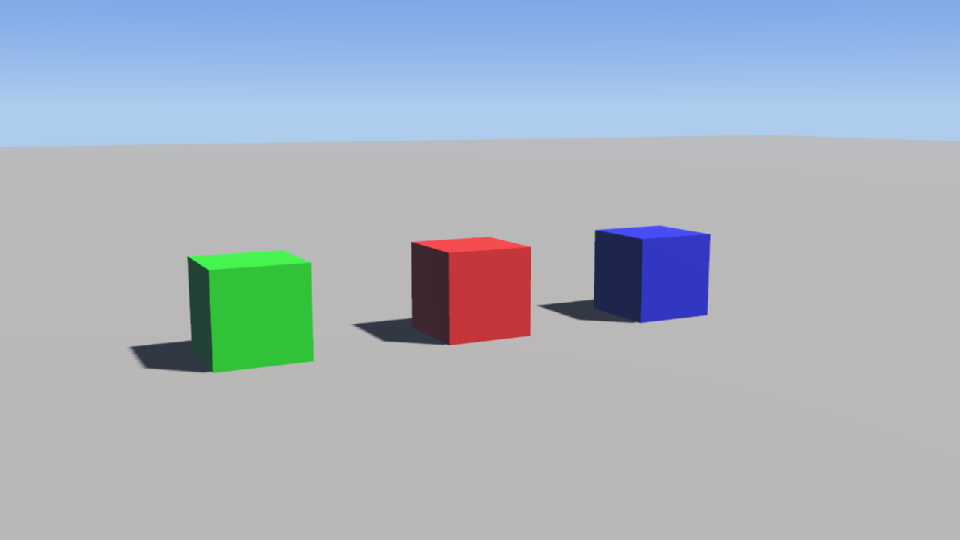
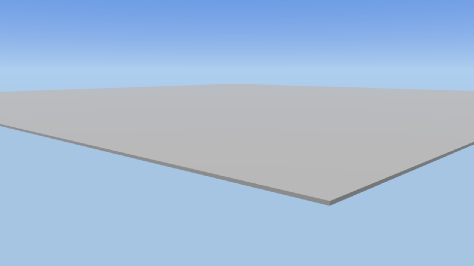

<p align="center">
  
</p>

# Wisko Engine

Wisko Engine (Wisko for short) is a free, open-source 3D game engine and editor for Windows and macOS. You build worlds
from simple parts and imported 3D models, bring them to life with Lua scripts, and press Play to try them right inside
the editor.

Wisko is for people who want to make small 3D games, prototypes and interactive scenes without a large, complicated
toolchain: hobbyists, students, and anyone learning game making and scripting.

**Status:** version 0.1.0 is Wisko's first release. It is young software: expect rough edges, and keep backups of
projects you care about. The macOS version is a **preview** in 0.1.0 (see [Platform support](#platform-support)).

## Screenshots

<p align="center">
  
  
</p>

The two New World templates, as Wisko renders them for its template screen (Universal renderer, Windows). The macOS
version draws worlds with the Classic renderer, without shadows (see [Platform support](#platform-support)).

## Installation

Download the package for your computer from the [Releases page](../../releases) of this repository.

### Windows

**Requirements:** Windows 11 (64-bit) and a graphics card with OpenGL 3.3. Windows 10 (version 1809 or later) is not
blocked, but it has not been tested for 0.1.0.

**Installer** (`Wisko-0.1.0-win-x64-setup.exe`):

1. Run the installer. It installs Wisko for your account only and needs no administrator rights. It can also copy the
   example projects for you.
2. Wisko is not code-signed yet, so Windows SmartScreen may warn about the download: choose **More info**, then
   **Run anyway**.
3. Start **Wisko** from the Start menu.

**Portable** (`Wisko-0.1.0-win-x64-portable.zip`): extract the zip anywhere and start `Wisko\Wisko.exe`. Nothing is
installed. The example projects are in `Wisko\Examples`; copy them into `Documents\Wisko\Projects` to see them in Wisko.

Model import and file dialogs need Microsoft's Visual C++ Redistributable (x64), version 14.44 or later, which most
computers already have. If yours does not, Wisko says so and offers Microsoft's download link. Everything else works
without it.

### macOS (preview)

The macOS version of 0.1.0 is a preview: it passes the automated tests, but the hands-on test on a real Mac is not
finished yet.

**Requirements:** a Mac with Apple silicon (M1 or later) and macOS 15 Sequoia or later. Intel-based Macs are not
supported.

1. Download the macOS zip and double-click it to unpack **Wisko Engine**.
2. Drag **Wisko Engine** into your **Applications** folder.
3. Open it. The macOS version of Wisko 0.1.0 is not yet signed with an Apple Developer ID or notarized by Apple, so the
   first time macOS refuses to open it. To allow it once:
   1. Open **System Settings > Privacy & Security**.
   2. Under **Security**, click **Open Anyway** for Wisko Engine (shown for about an hour after the attempt).
   3. Confirm with your password.

   After that, Wisko Engine opens normally.
4. If macOS asks whether Wisko Engine may access your Documents folder, allow it: Wisko keeps your projects there.

### Your projects and files

| | Windows | macOS |
|---|---|---|
| Projects | `Documents\Wisko\Projects` | `~/Documents/Wisko/Projects` |
| Log (for bug reports) | `%LOCALAPPDATA%\Wisko\Logs\Wisko.log` | `~/Library/Logs/Wisko/Wisko.log` |

A project is an ordinary folder of readable JSON files and assets. Uninstalling Wisko never deletes your projects.

## Features

- **World editor.** A Project Hub with template worlds and a history of recent projects. Five primitive shapes (cube,
  sphere, cylinder, wedge and pyramid) and imported models, with Move, Rotate and Resize tools; rotations can be typed
  in degrees; undo and redo. A World panel with groups, a deletable baseplate, a game GUI editor, and a script editor
  with code completion. See [docs/editor.md](docs/editor.md).
- **Play mode.** One click runs the world with physics and scripts; Stop restores it exactly as it was.
- **Lua scripting.** Standard Lua 5.4 in a sandbox with an instruction budget and a memory limit. The engine API covers
  movement and cameras, physics queries and forces, collision groups, joints, attributes and events, GUI, animation,
  navigation, perception, game time, saved games, particles, debug drawing, seeded randomness and noise, paths, and
  text-chat building blocks. Optional modules add dialogue, quests, crafting, building, races, weather and more. See
  [docs/lua-api.md](docs/lua-api.md) and [docs/lua-gameplay-systems.md](docs/lua-gameplay-systems.md).
- **Physics.** BepuPhysics: gravity, collisions, triggers, forces, joints and moving platforms.
- **Models and animation.** Import GLB / glTF, FBX and OBJ models; rigged models play their animation clips with
  blending, looping, speed and events, previewed in the editor and controlled from Lua. See
  [docs/animation.md](docs/animation.md).
- **Materials, lighting and graphics settings.** An Environment & Graphics panel for the sky, sun, ambient light, fog
  and the renderer. On Windows, the Universal renderer adds physically based materials and textures, point, spot and
  directional lights, shadows, HDR with tone mapping, bloom, ambient occlusion and toon shading, at Low to Ultra
  quality. See [docs/graphics.md](docs/graphics.md).
- **Safe saving.** Every project file is saved atomically, and a project's files are saved together, so a crash or a
  full disk during a save never leaves a damaged project.
- **Examples.** A gameplay basics demo, a gameplay systems showcase, an animation demo, a graphics showcase and a custom
  chat ([examples/](examples)).

## Lua scripting

Scripts are plain Lua 5.4 files in the project's `Assets/Scripts` folder. Select a part, choose **+ New Script** in the
Scripts panel, and write functions such as `Start` (once, when Play begins) and `Update(dt)` (every frame). For example,
on an anchored part:

```lua
function Start()
  print("Hello from Wisko")                      -- shown in the Output panel
  self.AngularVelocity = Vector3.new(0, 40, 0)  -- spin 40 degrees per second
end

function Update(dt)
  if Input.IsKeyPressed("E") then
    print("E pressed")
  end
end
```

Press **Play** to run it and **Stop** to put everything back. Scripts run in a sandbox: no file, operating-system or
network access (game saves go only to the project's own `Saves` folder), and a runaway loop or allocation stops that
script instead of the editor. The full API is in [docs/lua-api.md](docs/lua-api.md); what the sandbox does and does not
protect against is in [SECURITY.md](SECURITY.md).

## Importing models

In a saved project, choose **Add Meshes > Import Model…** and pick a `.glb`, `.gltf`, `.fbx` or `.obj` file. Wisko
copies it, and the files it needs, into the project's `Assets/Models` folder and places it in the world. Animated models
keep their clips, which you can preview in the Animation panel and play from Lua. See
[docs/animation.md](docs/animation.md).

## Platform support

| | Windows | macOS |
|---|---|---|
| Systems | Windows 11, 64-bit (tested); Windows 10 1809 or later (not verified) | macOS 15 or later on Apple silicon; a **preview** in 0.1.0 until the hands-on test on a real Mac has passed ([docs/macos.md](docs/macos.md)) |
| Graphics | OpenGL 3.3: the **Universal** renderer, and the Classic renderer for older projects | Metal: the **Classic** renderer |
| Shadows, PBR materials and textures, part lights, post-processing | yes | not drawn: the settings are kept in the project, so it looks right on Windows |
| Anti-aliasing | 4× MSAA | 4× MSAA |
| Animated models | skinned on the GPU | skinned on the CPU |
| Camera feeds (a camera's view in the game GUI) | yes | not drawn |
| Editor shortcuts | Ctrl (Ctrl+Z, Ctrl+S, …) | Command (Command+Z, Command+S, …) |

Linux is not supported.

## Building from source

This section is for developers. To use Wisko, download a release instead (see [Installation](#installation)).

**Requirements:**
- The [.NET 10 SDK](https://dotnet.microsoft.com/download/dotnet/10.0), version 10.0.402 or a later 10.0 SDK
  (`global.json`).
- On Windows, a graphics driver with OpenGL 3.3.
- On macOS, a Mac with Apple silicon, plus the Xcode Command Line Tools for building the app bundle.

```sh
dotnet build Wisko.sln
dotnet run --project Game                       # the editor; on Windows it uses OpenGL
dotnet run --project Game -- --renderer=bgfx    # on macOS: the editor on Metal, as the app uses it
```

Command-line options: `--projects <folder>` uses another projects folder, `--renderer=opengl` or `--renderer=bgfx` picks
the backend, and on macOS `--msaa=0`, `2` or `4` sets the anti-aliasing.

**Packages:**

```powershell
# Windows: the app folder, the portable zip and (with Inno Setup 6) the installer, in dist\
powershell -ExecutionPolicy Bypass -File scripts\build-windows-app.ps1 -Package
```

```sh
# macOS: dist/Wisko Engine.app (ad-hoc signed, for testing)
./scripts/build-macos-app.sh
```

See [docs/windows.md](docs/windows.md), [packaging/windows/README.md](packaging/windows/README.md) and
[docs/macos.md](docs/macos.md).

**Tests:**

```sh
dotnet run --project Tests/Wisko.Tests                   # the headless suite, on any OS
dotnet run --project Tests/Wisko.Tests -- --gui-smoke     # the real editor, driven by scripts (Windows)
```

See [Tests/Wisko.Tests/README.md](Tests/Wisko.Tests/README.md).

## Known limitations

- **macOS (preview):** the hands-on test on a real Mac is not finished. The Universal renderer, shadows, materials and
  textures, part lights and camera feeds are Windows-only; the Mac draws with the Classic renderer.
- **Unsigned packages:** Wisko is not code-signed yet, so Windows SmartScreen and macOS Gatekeeper warn about
  downloaded copies.
- **No networking:** chat and everything else are local only.
- **Physics on models:** imported models have no physics collider.
- **Text boxes:** the game GUI text box has no text selection, undo or IME composition window.
- **Trust:** open projects only from people you trust; scripts run on your computer (see [SECURITY.md](SECURITY.md)).

## Documentation

[docs/README.md](docs/README.md) lists every page: the editor, graphics, animation, Lua scripting, and the platform
notes.

## Contributing and security

Bug reports, fixes, documentation and examples are welcome: see [CONTRIBUTING.md](CONTRIBUTING.md). Please report
security problems privately, as described in [SECURITY.md](SECURITY.md).

## License

Wisko Engine's source code is licensed under the [Apache License 2.0](LICENSE). Copyright 2026 Wisko Industry
Development (see [NOTICE](NOTICE)).

Third-party libraries, fonts and models keep their own licenses: see [THIRD-PARTY-NOTICES.md](THIRD-PARTY-NOTICES.md).
The Wisko name and the golden W logo are reserved and are not covered by the Apache License: see
[BRANDING.md](BRANDING.md).
